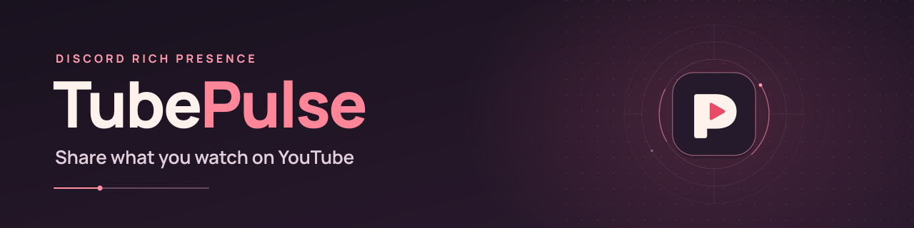

TubePulse shows the YouTube video you are watching as a Rich Presence activity in Discord Desktop. A Chrome extension reads the player and a Windows companion sends your selected details to Discord over a local named pipe. TubePulse is free and MIT-licensed.

## Install on Windows

You need Windows 10 or 11 (x64), an up-to-date Google Chrome, and the signed-in Discord Desktop app.

1. [Download TubePulse for Windows x64](https://github.com/TheLegendaryLord/tubepulse/releases/download/v0.1.2/TubePulse-0.1.2-windows-x64.zip), extract the ZIP and double-click **Install.cmd**.
2. In `chrome://extensions`, enable **Developer mode** and click **Load unpacked**. Choose the extension folder shown by setup and paste the ID from the TubePulse card back into setup.
3. After setup finishes, reload the extension on `chrome://extensions`. Open the TubePulse popup, choose what you want to share and turn TubePulse on. In Discord Desktop, enable activity sharing and play a YouTube video. [Discord activity sharing settings](https://support.discord.com/hc/en-us/articles/7931156448919-Activity-Sharing-on-Discord-FAQ)

The standard ZIP includes the runtime. If you already have Node.js 22.13+ or 24 LTS, download the [smaller Windows Lite ZIP](https://github.com/TheLegendaryLord/tubepulse/releases/download/v0.1.2/TubePulse-0.1.2-windows-lite.zip) and follow the same steps.

Chrome starts the companion as needed. Setup uses the public TubePulse Discord application by default. See the [Windows guide](docs/windows.md) for upgrades, checksums and custom application IDs.

The project also builds a ZIP containing just the Chrome extension. See the [Chrome Web Store guide](docs/chrome-web-store.md) for packaging and companion enrollment. [Privacy policy](docs/privacy.md) · [Terms](docs/terms.md)

## What Discord can show

- **Watching** for videos and Shorts, and **Listening** for YouTube Music when enabled.
- Video title, channel, a playback clock, a **Watch on YouTube** button and a thumbnail from YouTube’s image CDN. Discord controls the layout and rendering. The owner of an activity may not be able to click its buttons.
- Optional paused presence, without a running clock, up to the pause timeout set in the popup. Ended playback and closing the last eligible tab clear the activity.
- Playing tabs take priority over paused tabs. When multiple eligible tabs play, TubePulse prefers the focused player, then the most recently started player.

Use the popup to change what is shared or turn TubePulse off. **Privacy mode** keeps presence generic and removes title, channel, thumbnail, video link and timestamps before the companion receives an update. If you want to hide the identity of a video, use privacy mode or disable the link and thumbnail as well as the title and channel. Settings are stored locally. TubePulse reads supported top-level YouTube player pages and sends eligible data to the installed Discord client. Discord shares your activity according to your Discord settings.

TubePulse supports desktop YouTube watch pages (including playlists), Shorts and YouTube Music watch pages. It does not run in Incognito or track embedded players. YouTube can change the player markup or its ad indicators. Discord's **Activity shared** indicator in TubePulse means the Desktop client acknowledged the activity update. Visibility to other users depends on Discord and the account's activity settings.

## Troubleshooting and removal

| Symptom                                          | What to check                                                                                                                                                      |
| ------------------------------------------------ | ------------------------------------------------------------------------------------------------------------------------------------------------------------------ |
| YouTube stays idle                               | Reload YouTube after loading or updating the extension. Play a regular video outside an ad. Check Shorts and Music settings for those routes.                      |
| Companion is disconnected                        | Re-run the installer with the extension ID shown in your current Chrome profile. Reload the extension after updating the ID or Application ID.                     |
| Discord is connecting or reports an error        | Start and sign into Discord Desktop in the same Windows session. Check the Application ID in the installer. Restarting Discord triggers an automatic reconnect.    |
| Discord is connected but the activity is missing | Check Discord activity sharing and your current Discord status, then verify from another account. Another program can take priority in Discord’s activity display. |
| A thumbnail or button is missing                 | Check the separate popup toggles. The thumbnail can depend on the source image and Discord’s asset proxy. Check buttons from a viewer account.                     |

To uninstall, remove TubePulse at `chrome://extensions`, then run `powershell.exe -NoProfile -ExecutionPolicy Bypass -File .\Uninstall.ps1` from the extracted ZIP. The script removes local program files, the Native Messaging registration and the optional sign-in entry. If you created a Discord application solely for TubePulse, you can remove it separately in the Developer Portal.

## Build from source

Install official Node.js **24.22.2 x64** with npm on Windows. The Windows packaging script uses the Node distribution's `LICENSE` file alongside `node.exe`.

```powershell
git clone https://github.com/TheLegendaryLord/tubepulse.git
cd tubepulse
npm.cmd ci
npm.cmd run typecheck
npm.cmd run lint
npm.cmd run format:check
npm.cmd test
npm.cmd run package:windows
```

The build creates `apps/extension/dist` and `apps/companion/dist`. Packaging builds both and writes the Windows ZIP and its checksum to `artifacts/`. A successful [CI run](https://github.com/TheLegendaryLord/tubepulse/actions/workflows/ci.yml) also provides a build artifact. See the [architecture](docs/architecture.md), [validation checklist](docs/validation.md) and [contributor guide](CONTRIBUTING.md).
